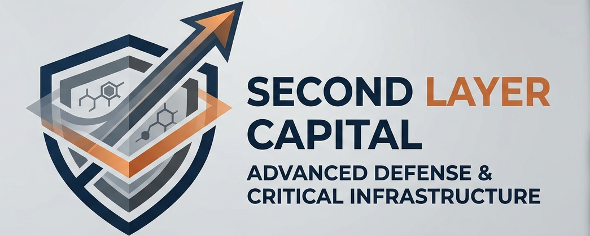

# Second Layer Capital — Hypersonic Defense Screener



A rules-based stock screening and portfolio management system
targeting the picks-and-shovels supply chain of next-generation
defense technology — hypersonic weapons, directed energy,
autonomous systems, and advanced propulsion.

Built by a 21-year U.S. Army veteran (Signal Corps, Infantry,
Civil Affairs) with a background in cybersecurity and critical
program protection.

---

## Thesis

The United States and its allies are entering a sustained period
of next-generation weapons development driven by peer competitor
threats from China and Russia. The supply chain beneath these
programs — propulsion manufacturers, advanced materials suppliers,
guidance systems makers, thermal protection specialists, and systems
integrators — will see durable, multi-decade government contract
flow regardless of which specific platforms win.

This screener targets that picks-and-shovels layer, not the prime
contractors.

---

## Universe

12 actively screened tickers across four technology domains:

- **AI & Autonomy** — PLTR, AVAV, KTOS
- **Hypersonic, Space & Propulsion** — KRMN, HWM, ATI
- **IoMT & Digital Battlefield** — AXON, TDY, HEI, LOAR, CW
- **Industrial Supply Chain** — MTRN

Watchlist (screened, not held): FLY, AADX, BAH.

---

## Scoring System

Each ticker receives a composite score (0-100) built from three components:

| Component | Weight | Source |
|-----------|--------|--------|
| Technical | 40% | Price data via yfinance |
| Fundamental | 40% | Revenue growth, margins, D/E via yfinance (cached) |
| Thesis | 20% | Manual alignment score |

Signal thresholds: STRONG ≥75 | NEUTRAL 50-74 | WEAK 25-49 | CRITICAL <25

---

## Rebalancing Rules

- **Shock triggers:** Position >13.5% or <6.5% of portfolio — immediate review
- **Drift triggers:** Position >2% from target for 30 consecutive days — queue for rebalance
- **Cash reserve:** 10% mandatory — never deployed by engine
- **Tier weights:** Disruptor 15% | Standard 10% | Anchor 5% (normalized)

Drift logging is currently paused (last entry Oct 4, 2026), so the 30-day drift gate cannot fire until logging resumes.

---

## Active Portfolio

Live portfolio managed via Robinhood Agentic account (••••5038). Costs below are from `screener/positions.py`, verified against the account.

| Ticker | Tier | Avg Cost |
|--------|------|---------|
| HWM | Standard | $244.88 |
| HEI | Standard | $316.23 |
| LOAR | Standard | $68.98 |
| AXON | Disruptor | $466.13 |
| CW | Standard | $746.50 |
| ATI | Standard | $220.00 |
| KRMN | Disruptor | $54.29 |
| KTOS | Disruptor | $45.35 |
| PLTR | Disruptor | $178.87 |

**Inception:** June 16, 2026

No return figure is listed here — it goes stale within days. Check the account for current value.

---

## Daily Briefing

The daily briefing is currently manual-only. The automatic weekday schedule in `.github/workflows/daily_briefing.yml` is disabled, and the workflow's install step is broken, so no briefing has run automatically since October 2026 (signal history last logged Oct 18, 2026). An automated-workflow fix exists but is parked.

To run a briefing by hand:

```
cd screener
python report.py
python signal_history.py
python drift_history.py
```

Briefings are saved to `logs/` and readable on iPhone via GitHub mobile.

No dashboard — the briefing is the interface.

---

## Status
🟢 Active — Phase 3 complete, screening live since June 2026. Execution is manual: the engine prints a copy-paste order payload; no code places a trade.

---

## Structure
/thesis — Investment thesis and rationale
/universe — Ticker universe and screening criteria
/screener — Scoring, signals, fundamentals, portfolio tracking,
rebalancing engine, intelligence module,
discovery scanner, earnings calendar,
signal/drift history, social media generator
/backtest — Backtesting methodology and results
/data — Cached fundamental data, signal history, drift history
/docs — CHANGELOG, STORY, screener specification
/logs — Daily briefings, intelligence, discovery, rebalance reports
.github — Automated workflows (daily briefing, weekly fundamentals)


---

## Social
- X: [@SecondLayerCap](https://x.com/SecondLayerCap)
- LinkedIn: [Second Layer Capital](https://www.linkedin.com/company/second-layer-capital)

---

## Disclaimer
This project is for personal research and educational purposes only.
Nothing here constitutes financial advice.
